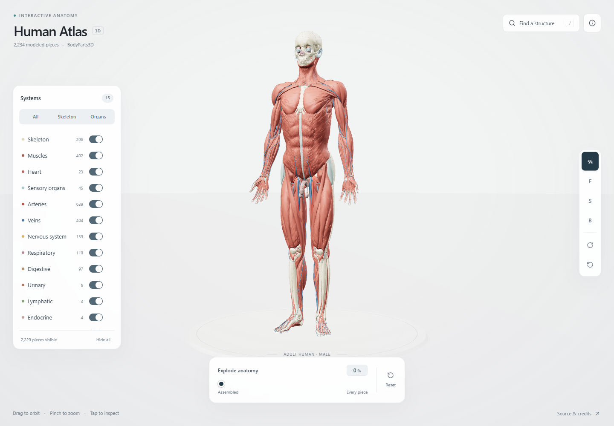
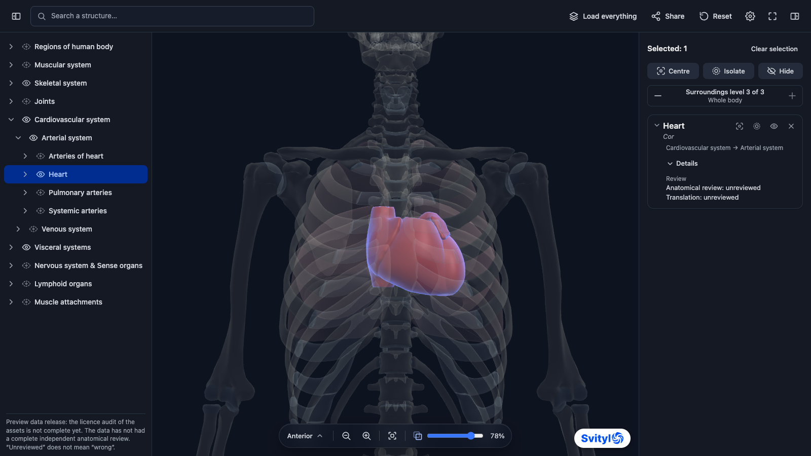
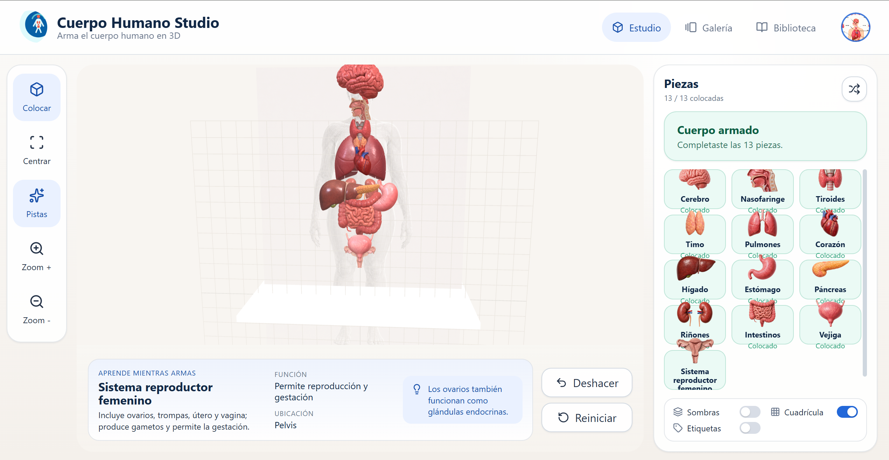
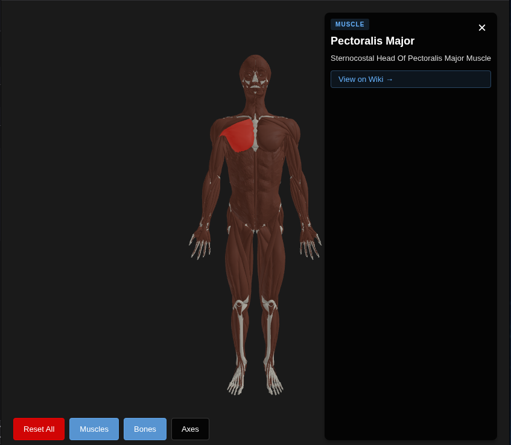

# 公开 3D 人体模型选型备忘

> 项目：中医数字人体状态可视化系统  
> 阶段：方案 A · 视觉冲刺  
> 日期：2026-11-15  
> 目标：优先选“已经公开、有模型照片、能拿到可运行资产”的人体模型；不自动旋转，只保留缩放与图层。

## 一句话结论

**主模型选 1 号 Human Atlas（ashemag/human-atlas）。**  
它的许可证最干净、器官/血管/神经最齐、网格可分离；视觉不是最惊艳，但可以通过黑色场景、半透明体表和器官材质重做达到目标。  
**2 号 Svitylo 只作为视觉参考，不作为生产资产**，因为它的数据许可证审计尚未完成。

---

## 1. Human Atlas（推荐）

- 仓库：[ashemag/human-atlas](https://github.com/ashemag/human-atlas)
- 在线演示已暂停，但仓库可本地运行。
- 数据：BodyParts3D 4.0，成年男性参考解剖。
- 规模：2,234 个可选中 mesh，15 个系统，3,432 个 FMA 概念。
- 器官：心、肺、肝、胃、肠、肾、膀胱、胆、胰、脑等；含动脉、静脉、神经系统。
- 资产：约 33 MB 压缩几何，15 个分块，可拆分懒加载。
- 技术：React + Three.js；代码 MIT，解剖数据 CC BY 4.0。
- 视觉：默认浅色教学风，不是黑底。需要二次改造：黑色场景、体表半透明/菲涅尔、器官低饱和材质、隐藏肌肉层。
- 适合：方案 A 的十页闭环、器官图层、病位标记、血管/神经展示。
- 风险：原始总包 33 MB，首屏需要减面/分包；胃壁没有四层结构，需要单独做剖面或叠层；模型是参考解剖，不是患者个体。

**结论：主模型。**  
许可证可商用（保留署名），器官覆盖足够，工程可控；视觉改造工作量比换模型小。

---

## 2. Svitylo 3D Anatomy Atlas（视觉最佳，但授权未清）

- 仓库：[authorOd/3d-anatomy-atlas](https://github.com/authorOd/3d-anatomy-atlas)
- 规模：4,454 个结构，约 300 万三角面；21 MB / 55 MB 两档分块。
- 视觉：黑底、半透明躯干、骨骼与心脏高亮，最接近你想要的“医院教学软件”质感。
- 技术：WebGL2 + Three.js，组件化，按结构懒加载。
- 许可：代码 CPAL-1.0；数据在 `preview` 频道，**许可证审计尚未完成**，且 README 明确写“未做解剖学审查”。
- 风险：不能假设可商用/可再分发；不适合作为正式产品资产。
- 适合：视觉参考、交互参考、内部技术验证。

**结论：只做参考，不进主资产。**  
如果只是内部演示且接受授权风险，可以作为临时视觉样片；正式版本不建议。

---

## 3. Cuerpo Humano 3D（器官特写好，但无许可证）

- 仓库：[jceronch1/Cuerpo-humano_3D](https://github.com/jceronch1/Cuerpo-humano_3D)
- 内容：13 个器官/系统 GLB，可拼装成半透明人体；肝脏、胃、肠、肾等材质不错。
- 视觉：浅色教育风，适合器官卡片和拼装演示；黑底需要重做。
- 资产：单个器官 GLB 大小差异很大，部分 70–98 MB，不适合直接 Web 加载。
- 许可：仓库根目录**没有 LICENSE 文件**，不能假设可商用或可再分发。
- 风险：授权不明；大文件；西班牙语内容和数据结构需要重做。

**结论：不推荐作为主模型。**  
可以作为“器官特写参考”，但不能直接用于对外产品。

---

## 4. Body Anatomy 3D Viewer（最轻，但只有肌肉/骨骼）

- 仓库：[hpfrei/body-anatomy-3d-viewer](https://github.com/hpfrei/body-anatomy-3d-viewer)
- 资产：`body.glb` 约 6.9 MB，DRACO 压缩，浏览器加载 1–3 秒。
- 内容：肌肉、骨骼、可点击分层；**没有脏腑、血管、神经**。
- 许可：模型来自 Z-Anatomy，CC BY-SA 4.0；项目同样 CC BY-SA 4.0（传染性 share-alike）。
- 适合：轻量人体外壳、骨骼/肌肉教学、低配设备兜底。
- 风险：不能单独满足中医脏腑可视化；ShareAlike 会影响衍生作品分发方式。

**结论：备选外壳，不做主模型。**  
如果首屏性能压力大，可以用它做“轻量体表/骨骼层”，器官层再按需加载。

---

## 选型对比

| 维度 | 1 Human Atlas | 2 Svitylo | 3 Cuerpo Humano | 4 Body Anatomy |
|---|---|---|---|---|
| 视觉接近度 | 中（可改造） | **高** | 中 | 中 |
| 器官完整度 | **高** | **高** | 中（单器官） | 低（无脏腑） |
| 血管/神经 | **有** | **有** | 无 | 无 |
| 浏览器体积 | 中（33 MB，可分块） | 中（21/55 MB 分块） | 差（部分 70–98 MB） | **好（6.9 MB）** |
| 许可证 | **MIT + CC BY 4.0** | CPAL + 数据待审计 | 无 LICENSE | CC BY-SA 4.0 |
| 可商用 | **可以（署名）** | 不确定 | 不确定 | 可以但需 ShareAlike |
| 工程改造量 | 中 | 中 | 高 | 低 |
| 建议 | **主模型** | 视觉参考 | 不推荐 | 轻量备选 |

---

## 方案 A 的落地建议

1. **主模型用 Human Atlas**，先保留“体表 + 脏腑 + 血管 + 神经”四层；肌肉层默认关闭。
2. **黑底改造**：Three.js 场景背景 `#05070A`；体表用菲涅尔半透明 Shader；器官用低饱和暖色；经络用金色细线。
3. **不旋转**：`OrbitControls.enableRotate = false`；只保留缩放、平移（可选）、图层开关、复位。初始相机正对正面。
4. **首屏控制**：只加载体表 + 心/肺/肝/胃/肾；其余器官按需加载；目标首屏 8–12 MB。
5. **胃壁四层**：Human Atlas 的胃是单层网格，方案 A 用“剖面 + 四层色带 + 标注”做示意，不伪装成真实四层解剖。
6. **病位标记**：基于器官中心点和包围盒计算锚点，最多 5 个；标签引线用 HTML overlay，避免 3D 文字模糊。
7. **署名**：应用内“素材与许可”页保留 BodyParts3D、CC BY 4.0、修改说明；代码 MIT 许可保留。

## 仍需确认

- 是否接受 Human Atlas 的成年男性参考解剖？如果需要女性模型，要另找 HRA 女性数据或做第二套。
- 是否接受“胃壁四层为示意色带”，还是必须做真实四层网格？
- 是否接受首屏 8–12 MB 的加载预算？
- Svitylo 如果只用于内部视觉参考，是否可以？
